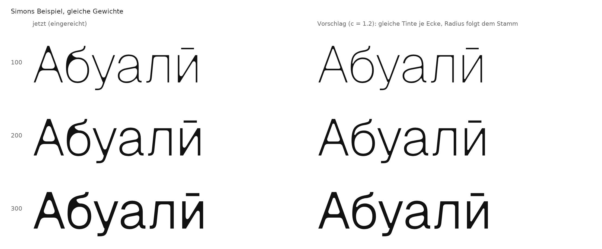
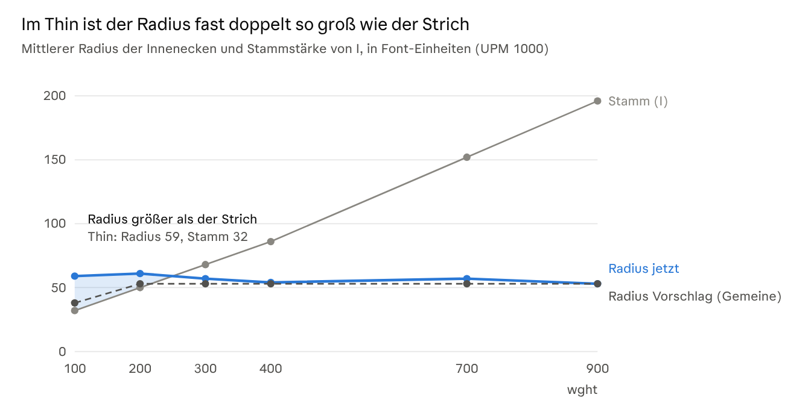
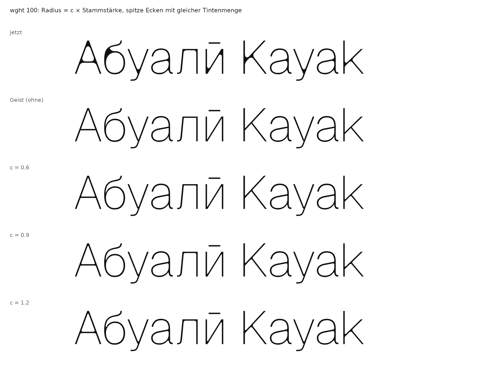
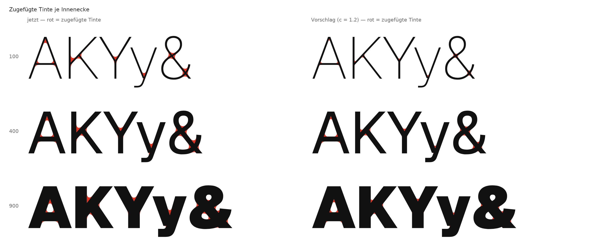
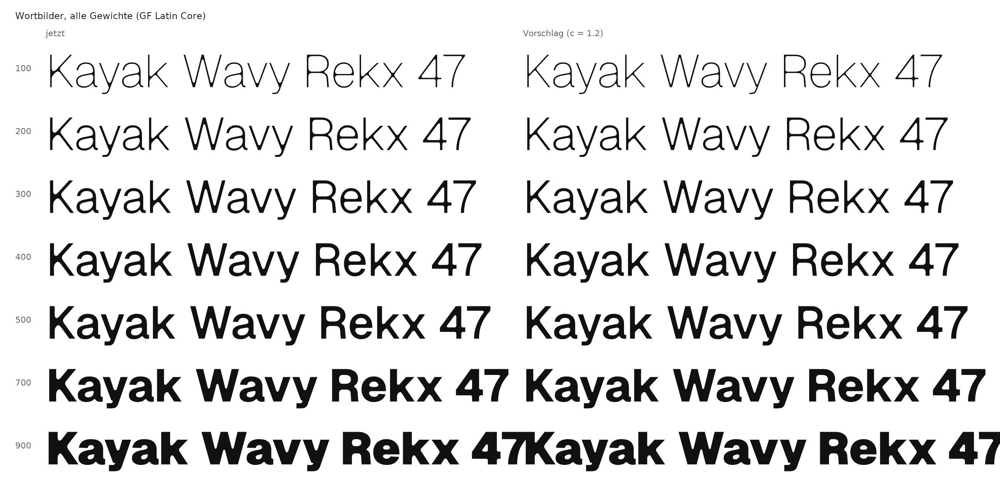

# Namche Shadow Sans – Rundungen: Diagnose und Regel

Stand 20.11.2026 · Michael Marte · Zu [Issue #125](https://github.com/NamcheAI/namche-fonts/issues/125)

## Kurzfassung

[Simon hat recht](https://github.com/google/fonts/issues/11180#issuecomment-6439385866): Die Rundungen verteilen die Tinte ungleich. Die Ursache ist ein fester Radius von rund 55–70 Einheiten, gleich in jedem Gewicht und in jedem Winkel. Wir ersetzen ihn durch eine Regel: Jede Innenecke bekommt gleich viel Tinte, und in den leichten Schnitten folgt der Radius dem Stamm.

Regular bis Black bleiben an rechtwinkligen Ecken genau wie freigegeben. Es ändern sich die leichten Schnitte und alle spitzen oder gekrümmten Anschlüsse.

Für Jodok: die Regel in `round_inner_corners.py` umsetzen, Upright und Italic damit neu bauen, dann die [Review-Seite](https://namche-latin-core-review.jodok7.chatgpt.site/) gegen den neuen Stand neu erzeugen. Bezug: [#118](https://github.com/NamcheAI/namche-fonts/issues/118), Branch `codex/gf-latin-core`.

## Was Simon sieht

Sein Bild ist wght 100 des eingereichten Upright-VF. Nachgebaut aus `main` sieht es identisch aus: Tropfen im б, Keile im у und й, eine Schwellung unter dem Querstrich im A. In wght 200 und 300 bleibt der Effekt, nur kleiner im Verhältnis zum Strich.

Der Branch `codex/gf-latin-core` hat kein Kyrillisch mehr. Simons Beispiel fällt damit weg, das Problem nicht: K, A, Y, y, &, # und $ zeigen es in Latin genauso.



## Ursache

Der Radius ist in allen Gewichten fast gleich, der Strich nicht. Im Thin ist der Radius 1,85-mal so dick wie der Stamm, im Black nur ein Viertel. Versalien runden sogar mit 70 Einheiten, also 2,2-mal der Thin-Stamm.



*Gemessen: Namche Shadow Sans VF (`codex/gf-latin-core`) gegen Geist 1.800, Fläche der Zusatztinte je Ecke in Radius umgerechnet · 6 Gewichte*

Dazu kommt der Winkel. Bei gleichem Radius bekommt eine 30°-Ecke 11-mal so viel Tinte wie eine rechtwinklige, eine 20°-Ecke 20-mal. Die Filterstufen −40/−50 gleichen das nur für gut 20 Zeichen aus (A V Z X ß, k v w x, M N W, 2 4 6 7 9). Alle anderen bekommen den vollen Radius, auch б у й a n K & # $. Am stärksten ist es beim K im Thin: 3,3 Stammquerschnitte Zusatztinte in einer einzigen Ecke.

Upright und Italic passen außerdem nicht zusammen. Die Italics wurden mit `--italic-recipe` gebacken: Radius je Master skaliert (0,55 / 1,00 / 1,35), aber ohne Ausgleich für spitze Ecken. Im Thin rundet das Italic mit etwa 22 Einheiten, das Upright mit 60–70.

## Die Regel

Zwei Regeln ersetzen den festen Radius und die Stufen pro Zeichen.

1. **Gleiche Tinte je Innenecke.** Jede Ecke bekommt dieselbe Zusatzfläche, egal wie spitz sie ist. Spitze Ecken und Anschlüsse an Kurven bekommen dafür einen kleineren Radius.
2. **Der Radius folgt dem Stamm, bis zur heutigen Obergrenze.** In den leichten Schnitten schrumpft er mit dem Strich. Ab etwa wght 250 bleibt er bei den heutigen Werten: 70 für Versalien und Ziffern, 53 für den Rest.

```math
r_{90} = \min(c \cdot s,\; r_{\max}), \qquad A^{*} = \left(1 - \tfrac{\pi}{4}\right) r_{90}^{2}
```

```math
A(r, \theta) = r^{2}\left(\cot\tfrac{\theta}{2} - \tfrac{\pi - \theta}{2}\right) \;\Rightarrow\; r(\theta) = r_{90}\sqrt{\frac{1 - \pi/4}{\cot(\theta/2) - (\pi - \theta)/2}}
```

Dabei ist s die Stammstärke von I im jeweiligen Master, θ der Winkel der weißen Ecke und c = 1,2. Stumpfe Ecken über 90° behalten r90. Platzgrenze: Die Rundung reicht höchstens 45 % der Strecke bis zur nächsten Ecke, damit kurze Sporne (etwa über der n-Schulter) nicht verschwinden.

Bei Kurvenanschlüssen stimmt die Formel nur ungefähr. Der Prototyp löst den Radius deshalb je Ecke so, dass die tatsächlich gefüllte Fläche A* trifft.

c bestimmt nur die Wirkung im Thin und ExtraLight; gesetzt ist c = 1,2 (0,9 wäre leiser, 0,6 kaum sichtbar).



## Ergebnis des Prototyps

Mit der Regel bekommen spitze und rechtwinklige Ecken gleich viel Tinte, und der größte Tropfen im Thin schrumpft auf ein Zehntel. Gemessen wurde gegen Geist an 46 Zeichen in 6 Gewichten.

| Messung | jetzt | Vorschlag |
| --- | --- | --- |
| Tinte spitze Ecke (unter 60°) zu rechtwinkliger Ecke, Gemeine | 1,3 bis 2,2 | 1,0 |
| Größte Zusatztinte einer Ecke im Thin, in Stammquerschnitten | 3,3 (K) | 0,32 |
| Rechtwinklige Ecken ab wght 250 | 70 / 53 Einheiten | unverändert |
| Prüflauf 76 Zeichen × 7 Gewichte: zugelaufene Punzen, verlorene Tinte | – | 0 / 0 |





Der Prototyp baut die Ecken aus den Geist-Instanzen neu auf. Seine Konturen sind nicht interpolierbar und nur zum Ansehen gedacht. Skripte und LIESMICH liegen in [`prototype/`](prototype/).

## Umsetzung im Build (Jodok)

Die Regel gehört in die vorhandene Engine `scripts/round_inner_corners.py`, nicht in die Glyphs-Filter. Die Engine rundet schon kompatibel über alle Master und nimmt spitze Ecken bereits zurück, nur zu wenig: linear mit Boden 0,32. Das gibt bei 60° 1,4-mal, bei 20° 2-mal und bei 10° 4,7-mal zu viel Tinte. Die fast tangentialen Anschlüsse (б, a, n-Schulter) treffen genau diesen Fall.

1. `angle_adjusted_radius` durch die Formel aus „Die Regel“ ersetzen, ohne Boden. `capped_radius` und `acute_mouth_cap` bleiben als Platzgrenze.
2. Radius je Master und Gruppe aus dem Stamm ableiten statt `MASTER_RADIUS_SCALE`: r90 = min(1,2 × Stamm, 70 Versalien und Ziffern / 53 Rest). Thin (Stamm 32) ergibt 38, Regular und Black 70 / 53.
3. Damit Upright und Italic backen. Das Upright braucht dann keinen Glyphs-Export mit dem 7-stufigen Filterstapel mehr; `roundcorner_shadow_filters.txt` und die Stufen pro Zeichen fallen weg.
4. Die Italics neu backen, nicht mehr mit `--italic-recipe`.
5. Neubau beider VFs und der Statics, dann `check_sans_counters.py`, Fontspector und Wortproofs. Die Proofs sollten den Prototyp-Bildern in diesem Dokument entsprechen.
6. Review-Seite gegen den neuen Stand neu erzeugen.

Zwischenstufen interpoliert der VF zwischen den Mastern. ExtraLight landet dadurch bei etwa 43 statt 53 Einheiten. Das ist unkritisch; ein Zwischenmaster wäre nur nötig, wenn es im Proof auffällt.

Nebeneffekt: Wenn auch das Upright aus den Quellen gebacken wird, reproduziert `gftools builder` beide Stile direkt. Das beantwortet zum Teil auch Simons Frage zum unübersichtlichen Build.

## Was mit der Review-Seite passiert

Von den 19 Fragen der [Review-Seite](https://namche-latin-core-review.jodok7.chatgpt.site/) beantwortet die Regel 8, 3 werden am neuen Build entschieden, 8 haben mit der Rundung nichts zu tun. Den Sans-Teil bis zum Neubau pausieren; Mono und Shape können jetzt beantwortet werden.

| Nr | Familie | Thema | Zeichen | Status | Anmerkung |
| --- | --- | --- | --- | --- | --- |
| 1 | Sans | Kreuzende Striche | # $ ¢ £ ¥ Ð Ø ð ø Đ đ Ħ ħ Ł ł € | durch Regel erledigt | |
| 2 | Sans | Taille und Kreuzungen, fett | & § | nach Neubau prüfen | Regel ändert im Fetten nur spitze Ecken |
| 3 | Sans | Querstrich und Punze | A À Á Â Ã Ä Å Ā Ă Ą | nach Neubau prüfen | Schwellung im Thin erledigt, Punze im Black prüfen |
| 4 | Sans | Diagonal-Anschlüsse | K R W X Y k w x Ý Ķ ķ Ŕ Ř Ŵ ŵ Ŷ … | durch Regel erledigt | |
| 5 | Sans | Schweif und Bauch | Q | durch Regel erledigt | |
| 6 | Sans | Bauch-Stamm unten | a à á â ã ä å ā ă ą | durch Regel erledigt | |
| 7 | Sans | Bauch-Stamm-Kontrast | b d p q Þ þ ď | durch Regel erledigt | |
| 8 | Sans | Enge Öffnungen, fett | e è é ê ë ē ė ę ě | bleibt offen | Geist-Form im Black, keine Rundungsfrage |
| 9 | Sans | Unterlänge und Bauch | g ğ ġ ģ | durch Regel erledigt | |
| 10 | Sans | Schultern | h m n r ñ ń ņ ň ŕ ř | durch Regel erledigt | |
| 11 | Sans | Untere Diagonale | y ý ÿ ŷ ỳ | durch Regel erledigt | |
| 12 | Sans | Kleine Punzen | ª º | bleibt offen | Größe unter Atlas-Größe prüfen |
| 13 | Sans | Mittelknoten, fett | Æ æ Œ œ | nach Neubau prüfen | wie Nr. 2 |
| 14 | Mono | Gestauchte Punzen | @ Æ æ Œ œ | bleibt offen | Konturen sind unverändert Geist Mono |
| 15 | Mono | Ogonek-Anschluss | U+0328 | bleibt offen | Anker-Positionierung |
| 16 | Shape | Dichte an Kreuzungen | # $ & @ ¥ € | bleibt offen | |
| 17 | Shape | Akzentgewicht | 162 Zeichen | bleibt offen | |
| 18 | Shape | Ogonek-Abstand | Ą ą Ę ę Į į Ų ų | bleibt offen | |
| 19 | Shape | Textur von ™ | ™ | bleibt offen | |

## Antwort an Simon und nächste Schritte

Die Antwort kann jetzt raus, mit den Prototyp-Bildern; der Neubau folgt. Die Klammer füllt Mitch mit einem Satz zum Konzept. Gepostet wird auf google/fonts nur mit ausdrücklicher Freigabe (siehe #118).

> Thanks, fair point, and the screenshot shows it well. The pooling itself is intended: [one sentence on the Shadow idea]. The unevenness is not. The current build applies a fixed corner radius (≈55–70 units) at every weight and every angle, so in Thin (stem 32 units) the fills are about twice the stroke width, and acute joins receive many times more ink than right-angle ones. We are replacing this with a rule: every inner corner receives the same amount of ink, the radius scales with stem weight in the light weights, and acute or curved joins get a correspondingly smaller radius. Before/after proofs attached. We'll rebuild the masters with this and update the PR.

- [ ] Mitch: Konzeptsatz einsetzen
- [ ] Jodok oder Mitch: Antwort an Simon in [google/fonts#11180](https://github.com/google/fonts/issues/11180) posten, englische Bilder aus diesem Ordner anhängen
- [ ] Jodok: Regel in `round_inner_corners.py` umsetzen, Upright und Italic neu backen
- [ ] Jodok: Neubau prüfen, dann die Review-Seite neu erzeugen
- [ ] Mitch: Mono- und Shape-Fragen (Nr. 14–19) schon jetzt beantworten
